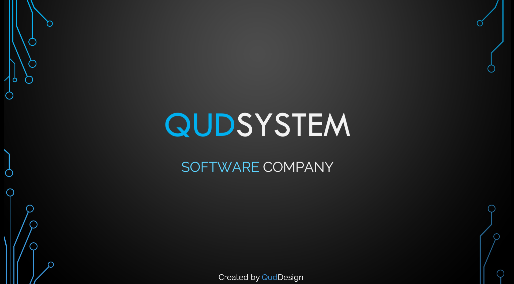

# QudSystem.Ltd | Software, AI & Cybersecurity Ecosystem

Welcome to the official repository of **QudSystem** (`QudSystem.Ltd`). We engineer autonomous AI systems, offensive/defensive cybersecurity platforms, scalable SaaS products, and smart hardware integrations designed to transform and secure modern enterprises.

🌐 **Live Web Application:** [QudSystem Portal](https://qud-system-software-company-it-solutions-web-application.vercel.app)

## 🚀 Core Divisions & Flagship Products

### 1. Cybersecurity & Autonomous Security Agents
* **Dragon R1:** Autonomous offensive penetration testing and ethical hacking multi-agent platform.
* **Dragon B1:** Proactive defensive monitoring, threat detection, and incident response system.
* **ProtectX & PenRate:** Enterprise vulnerability auditing and continuous security rating tools.
* **Vision Guard Systems:** Smart surveillance and physical security infrastructure solutions.

### 2. Artificial Intelligence & Developer Tooling
* **QudMind 2.5 Labs & Agent3.5:** Autonomous multi-agent workflows and custom LLM orchestration.
* **Mimo-cli-max:** Standalone intelligent command-line automation and developer productivity suite.
* **CVPEN:** AI-powered resume engineering, ATS evaluation, and career optimization micro-SaaS.
* **Kenzy AI:** Generative AI storytelling and voice-narrated visual media engine.

### 3. Enterprise SaaS, EdTech & Digital Platforms
* **QudSoft & Qud Project:** Custom multi-tenant SaaS architectures and enterprise resource systems.
* **Qud School & Qudemy:** Next-generation interactive educational and technical training platforms.
* **MyHowia:** Secure mobile digital identity and personal document wallet.
* **BuildX:** AI-assisted architectural renovation and spatial planning platform.
* **DMA & Social Media Forge:** Smart digital marketing automation, interactive invitations, and signage solutions.
* **Volt Motors:** Smart electric mobility and hardware friction-booster engineering.

## 🛠️ Technology Stack

| Layer | Technologies |
| :--- | :--- |
| **AI & Agents** | LangGraph, CrewAI, Ollama, Python, Custom MCP Integrations |
| **Frontend & Mobile** | Next.js, React, TypeScript, Tailwind CSS, Jetpack Compose, Flutter |
| **Backend & Data** | Node.js, Python (FastAPI/Django), PostgreSQL, MongoDB, Prisma |
| **DevOps & Infra** | Docker, Nix, GitHub Actions, Cloudflare Workers, Vercel, Linux |
| **Cybersecurity** | Autonomous Recon Agents, Wireshark, Splunk, Cisco IDS, Custom Exploits |

## 🤝 Connect With QudSystem

* **Website:** [qud-system-software-company-it-solutions-web-application.vercel.app](https://qud-system-software-company-it-solutions-web-application.vercel.app)
* **GitHub Organization:** [QudSystem](https://github.com/Qudsystem)
* **Lead Architect:** [Hussam Galal](https://github.com/hussamgalal999)

## 📄 License

This repository and its contents are licensed under the [MIT License](./LICENSE.md).
